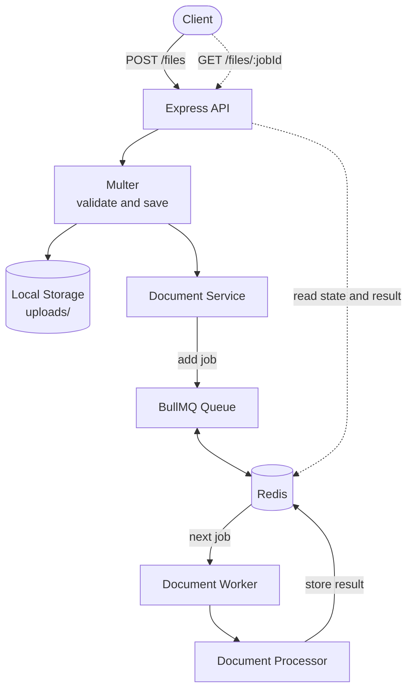

<div align="center">

# 📬 Message Queue

**Asynchronous document processing, powered by Express, Redis & BullMQ.**

Upload a text or Markdown file, get a job ID instantly, and let a background worker do the heavy lifting.

<br />


[Features](#-features) · [Architecture](#-architecture) · [Quick Start](#-quick-start) · [API Reference](#-api-reference) · [Roadmap](#-roadmap)

</div>

---

## ✨ Features

|                                   |                                                                           |
| --------------------------------- | ------------------------------------------------------------------------- |
| 📤 **File uploads**               | Accepts `.txt` and `.md` files with extension validation and a 5 MB limit |
| ⚙️ **Background processing**      | BullMQ jobs run in a separate worker, so the API stays fast               |
| 📊 **Document statistics**        | Word count, character count, line count, reading time, and top 10 words   |
| 🔎 **Job tracking**               | Check status and fetch results at any time using a job ID                 |
| 🔁 **Automatic retries**          | Failed jobs retry up to 3 times with exponential backoff                  |
| 🛡️ **Centralized error handling** | Consistent error responses across the API                                 |
| 👀 **Visual monitoring**          | Redis Insight included via Docker Compose                                 |

---

## 🧰 Tech Stack

| Technology         | Purpose                          |
| ------------------ | -------------------------------- |
| **Node.js**        | JavaScript runtime               |
| **TypeScript**     | Static typing                    |
| **Express 5**      | HTTP server and API              |
| **BullMQ**         | Background job processing        |
| **Redis**          | Queue storage and job management |
| **Multer**         | File upload handling             |
| **Docker Compose** | Redis and Redis Insight          |
| **pnpm**           | Package management               |

---

## 🏗️ Architecture

The application separates **HTTP request handling** from **background job processing**. The API only accepts files and enqueues work; a standalone worker does the processing.



### Processing workflow

1. 📥 The client uploads a document through the API.
2. 🧪 Multer validates the file extension and size.
3. 💾 The file is saved to the local `uploads/` directory.
4. 📨 The document service adds a processing job to the BullMQ queue.
5. 🗄️ Redis stores the queued job.
6. 🛠️ The worker picks up and processes the job.
7. 📈 The processor generates document statistics.
8. ✅ BullMQ stores the result.
9. 🔍 The client retrieves the status and result using the job ID.

---

## 📁 Project Structure

```text
message-queue/
├── src/
│   ├── config/
│   │   └── redis.connection.ts
│   ├── middleware/
│   │   ├── error.middleware.ts
│   │   └── upload.middleware.ts
│   ├── processors/
│   │   └── document.processor.ts
│   ├── queues/
│   │   └── document.queue.ts
│   ├── routes/
│   │   └── file.routes.ts
│   ├── services/
│   │   ├── document.service.ts
│   │   └── job.service.ts
│   ├── types/
│   │   └── document.ts
│   ├── workers/
│   │   └── document.worker.ts
│   └── server.ts
├── uploads/
├── .env
├── .env.example
├── .gitignore
├── compose.yaml
├── package.json
├── pnpm-lock.yaml
├── pnpm-workspace.yaml
└── tsconfig.json
```

---

## 🚀 Quick Start

### Prerequisites

- [Node.js](https://nodejs.org/)
- [pnpm](https://pnpm.io/)
- [Docker](https://www.docker.com/) and Docker Compose

### 1. Install dependencies

```bash
cd message-queue
pnpm install
```

### 2. Configure environment variables

Create a `.env` file using `.env.example` as a reference:

```env
PORT=3000
REDIS_URL=redis://localhost:6379
```

### 3. Start Redis and Redis Insight

```bash
docker compose up -d
```

<details>
<summary><b>Verify that everything is running</b></summary>

<br />

Check the containers:

```bash
docker compose ps
```

Ping Redis:

```bash
docker exec -it redis redis-cli ping
```

Expected response:

```text
PONG
```

</details>

### 4. Start the API server

```bash
pnpm dev
```

The API is now available at **http://localhost:3000**.

### 5. Start the worker

In a **second terminal**, inside the same directory:

```bash
pnpm dev:worker
```

> [!NOTE]
> The worker runs separately from the API server. Jobs will stay in the `waiting` state until a worker is running.

### 6. Type-check (optional)

```bash
pnpm typecheck
```

---

## 📡 API Reference

**Base URL:** `http://localhost:3000`

| Method | Endpoint        | Description                                   |
| ------ | --------------- | --------------------------------------------- |
| `GET`  | `/`             | API info and available endpoints              |
| `GET`  | `/health`       | Server health check                           |
| `POST` | `/files`        | Upload a document and queue it for processing |
| `GET`  | `/files/:jobId` | Get job status and result                     |

### `GET /`

Returns basic information about the API and its endpoints.

<details>
<summary><b>Response · <code>200 OK</code></b></summary>

```json
{
  "name": "Message Queue API",
  "description": "Asynchronous document processing API powered by BullMQ and Redis.",
  "endpoints": {
    "health": "GET /health",
    "upload": "POST /files",
    "jobStatus": "GET /files/:jobId"
  }
}
```

</details>

### `GET /health`

Checks whether the API server is running.

<details>
<summary><b>Response · <code>200 OK</code></b></summary>

```json
{
  "status": "ok",
  "timestamp": "2026-11-03T12:00:00.000Z"
}
```

</details>

### `POST /files`

Uploads a document and adds a processing job to the queue.

| Property         | Value                 |
| ---------------- | --------------------- |
| Content-Type     | `multipart/form-data` |
| Field name       | `file`                |
| Accepted formats | `.txt`, `.md`         |
| Maximum size     | 5 MB                  |

**Example**

```bash
curl -X POST http://localhost:3000/files \
  -F "file=@sample.txt"
```

<details open>
<summary><b>Response · <code>202 Accepted</code></b></summary>

```json
{
  "message": "File uploaded and queued for processing.",
  "jobId": "2",
  "status": "waiting"
}
```

</details>

### `GET /files/:jobId`

Retrieves the processing status and result of a job.

**Example**

```bash
curl http://localhost:3000/files/2
```

<details open>
<summary><b>Response · <code>200 OK</code></b></summary>

```json
{
  "jobId": "2",
  "state": "completed",
  "result": {
    "filename": "sample.txt",
    "wordCount": 20,
    "characterCount": 127,
    "lineCount": 3,
    "readingTime": 1,
    "topWords": [
      { "word": "javascript", "count": 3 },
      { "word": "is", "count": 2 }
    ]
  }
}
```

The `state` field reflects the current job state: `waiting`, `active`, `completed`, or `failed`.

</details>

<details>
<summary><b>Response · <code>404 Not Found</code></b></summary>

<br />

Returned when the requested job ID does not exist.

</details>

---

## ⚙️ Queue Configuration

The document-processing queue uses these default job options:

| Option             | Configuration | Description                         |
| ------------------ | ------------- | ----------------------------------- |
| Attempts           | `3`           | Maximum processing attempts         |
| Backoff type       | `exponential` | Increases the delay between retries |
| Initial delay      | `1000 ms`     | Initial retry delay                 |
| Remove on complete | `false`       | Retains completed jobs              |
| Remove on fail     | `false`       | Retains failed jobs                 |

Completed and failed jobs are retained so their status and results can be retrieved through the API.

---

## 👀 Redis Insight

Redis Insight is available at **http://localhost:5540**.

To connect to the Redis instance:

| Setting | Value   |
| ------- | ------- |
| Host    | `redis` |
| Port    | `6379`  |

Use it to inspect Redis data and monitor queue activity.

---

## 🔒 File Upload Restrictions

| Restriction         | Value            |
| ------------------- | ---------------- |
| Accepted extensions | `.txt`, `.md`    |
| Maximum file size   | 5 MB             |
| Storage             | Local filesystem |
| Filename            | UUID-based       |

> [!WARNING]
> Uploads are restricted by file extension only. The application does not currently inspect file contents to verify their actual format.

---

## 🛑 Stopping the Services

Stop the API server and worker with `Ctrl + C` in their terminals, then stop the containers:

```bash
docker compose down
```

To also remove the containers and their persistent volumes:

```bash
docker compose down -v
```

> [!CAUTION]
> The `-v` option deletes the Redis and Redis Insight volumes, including persisted Redis data.

---

<div align="center">

Built with ☕ using Node.js, TypeScript, Express, Redis & BullMQ

</div>
